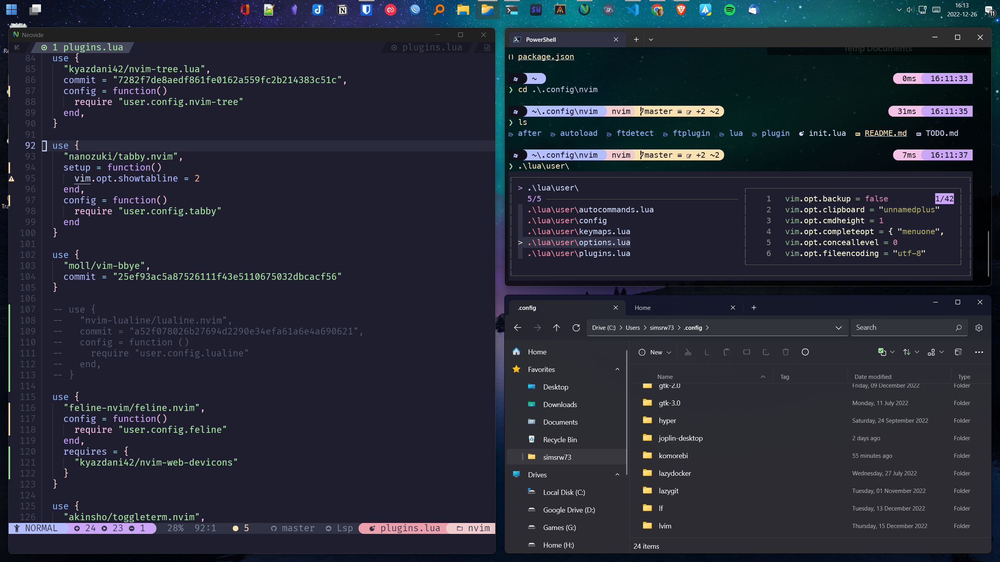
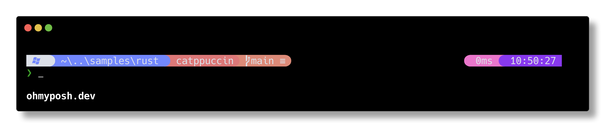
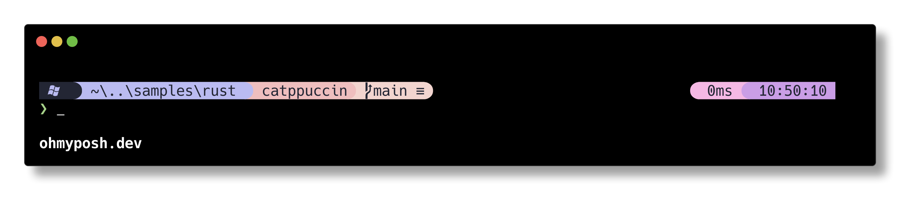
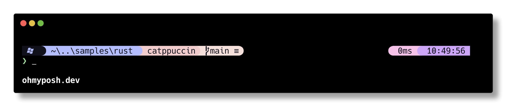
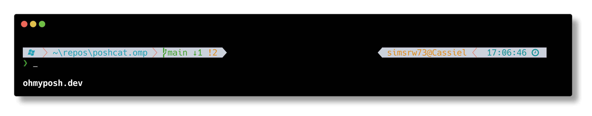
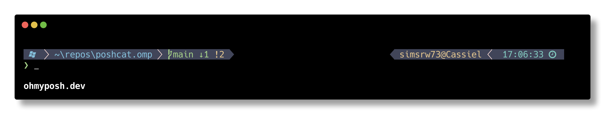
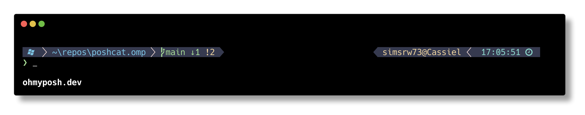
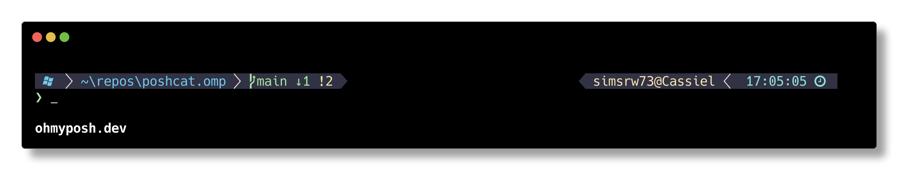

<h3 align="center">
	<br/>
	
	Catppuccin Themes for <a href="https://ohmyposh.dev/">Oh My Posh</a>
	
</h3>



## PoshCat Theme

This theme follows the majority of Oh-My-Posh themes by presenting each segment in a rainbow of colors. It's not my preferred design choice, but it appears to be an extremely common choice.

<details>
<summary>🌻 Latte</summary>

</details>

<details>
<summary>🪴 Frappé</summary>

</details>

<details>
<summary>🌺 Macchiato</summary>

</details>

<details>
<summary>🌿 Mocha</summary>

</details>

## PoshCat-Decaffeinated

This theme is more sane version of the above theme where we minimize the number of colors.

...

## CatPow Theme

This theme is designed to mimic the Powerlevel10k theme.

<details>
<summary>🌻 Latte</summary>

</details>

<details>
<summary>🪴 Frappé</summary>

</details>

<details>
<summary>🌺 Macchiato</summary>

</details>

<details>
<summary>🌿 Mocha</summary>

</details>

## Usage

1. Clone this repository locally.
2. Open the file "poshcat.omp.json" and set the `"template"` property to the theme variation of your choice: "Mocha", "Macchiato", "Frappe", or "Latte".
    ```
    "palettes": {
         "template": "Mocha",
         ...
    ```
3. Initialize `oh-my-posh` with the config file according to the shell you are using. See the [Oh My Posh Docs](https://ohmyposh.dev/docs/installation/customize) for details.

## Related

These themes started my prompt setup. These are the projects around it:

- **[dotfiles-windows](https://github.com/simsrw73/dotfiles-windows)**: My whole Windows setup, managed with chezmoi: `~/.config`, the PowerShell profile, apps, keys and secrets. The other projects here are either used by it or published from it.
- **[w11dwm-config](https://github.com/simsrw73/w11dwm-config)**: The keyboard-driven tiling desktop (komorebi, AutoHotkey, yasb, Flow Launcher, wpm), copied out of dotfiles-windows to share and discuss. Its key bindings, app launcher and window switcher are built on Legend.ahk.
- **[catelier](https://github.com/simsrw73/catelier)**: A Catppuccin theme for the yasb status bar, in all four flavors with your choice of accent. It's the bar in w11dwm-config and dotfiles-windows.
- **[Legend.ahk](https://github.com/simsrw73/Legend.ahk)**: An AutoHotkey v2 library: an Alt+/ overlay of the shortcuts for the app you're in, which-key style chord menus, pickers and a window switcher. It runs the keys in w11dwm-config and dotfiles-windows.
- **[DotForge](https://github.com/simsrw73/DotForge)**: A PowerShell module that installs and configures command-line tools: XDG paths, fzf pickers, completions, shell hooks. The PowerShell profile in dotfiles-windows loads it, and it sets up Starship to read the starship-p9cat config.
- **[starship-p9cat](https://github.com/simsrw73/starship-p9cat)**: A Starship prompt in the powerlevel9k style, in Catppuccin colors. It's the prompt in dotfiles-windows, and a port of the CatPow theme from poshcat.omp.

<p align="center">
	
</p>

<p align="center">
	<a href="https://github.com/catppuccin/catppuccin/blob/main/LICENSE"></a>
</p>

This is a test
